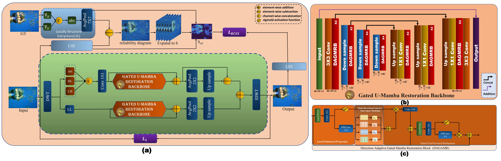
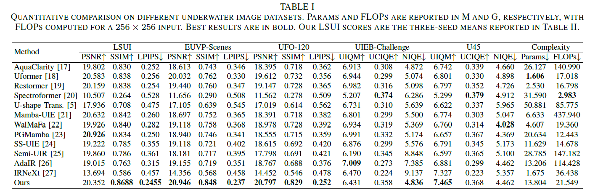
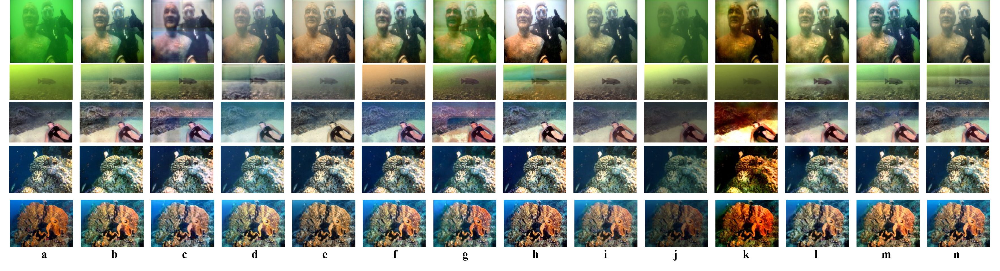

# RCSS

RCSS is an underwater image enhancement method designed to restore color, contrast, and structural details in degraded underwater scenes.

This repository currently provides the network architecture, quantitative results, and visual comparisons of RCSS.

## Overview

RCSS combines a Gated U-Mamba restoration backbone with local structure extraction and reliability-aware supervision. The model processes frequency components through two restoration branches and reconstructs the enhanced image with an inverse discrete wavelet transform.

  

The framework contains:

- a **Gated U-Mamba Restoration Backbone** for multi-scale feature restoration;
- a **Direction-Adaptive Gated Mamba Restoration Block (DAGMR)** for local and long-range feature modeling;
- a **Local Structure Extraction (LSE)** module for structure-aware supervision;
- an **RCSS objective** that uses reliability information to guide restoration.

## Quantitative Results

RCSS is evaluated on five underwater image enhancement benchmarks: LSUI, EUVP-Scenes, UFO-120, UIEB-Challenge, and U45.

  

For a 256 × 256 input, the model contains **13.804 M parameters** and requires **21.549 G FLOPs**.

## Visual Comparisons

  

RCSS restores more natural colors and improves visibility while preserving scene structures and fine details.

## Citation

If you find this project useful, please consider citing the corresponding paper. Citation information will be added after publication.

## Contact

For questions about this project, please open an issue in this repository.
